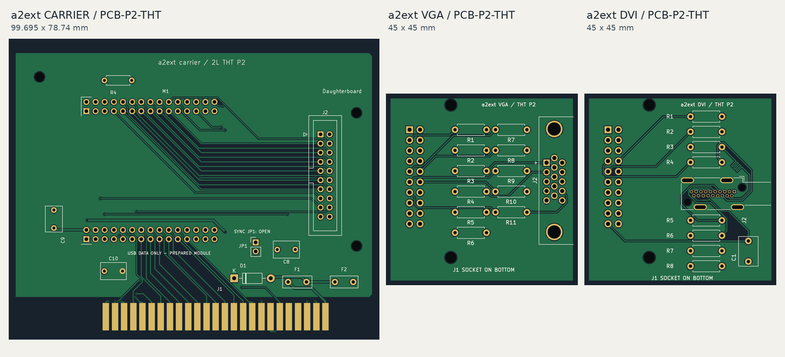

# Two-layer prototype fabrication and assembly

Revision **PCB-P2-THT**, 2026-10-12, supersedes the PCB-P1 SMD fabrication files.
All three boards use through-hole components, retaining the existing electrical
contracts. Carrier D1 changes from SS14/SMA to 1N5819/DO-41 with the same
Schottky function and polarity. KiCad 10.0.7 ERC, DRC including warnings/exclusions, schematic parity,
and physical pad-to-net checks pass with zero findings. The power, timing,
thermal and monitor tests in [HARDWARE-VALIDATION.md](../docs/HARDWARE-VALIDATION.md)
remain open. These files are for prototype fabrication.

## Deliverables

| Board | Outline dimensions | Editable board | Fabrication ZIP |
|---|---|---|---|
| Carrier | 99.695 x 78.74 mm including tab | [KiCad PCB](a2ext-carrier/a2ext-carrier.kicad_pcb) | [Gerbers/drills](a2ext-carrier/a2ext-carrier-gerbers.zip) |
| VGA | 45 x 45 mm | [KiCad PCB](a2ext-vga/a2ext-vga.kicad_pcb) | [Gerbers/drills](a2ext-vga/a2ext-vga-gerbers.zip) |
| DVI | 45 x 45 mm | [KiCad PCB](a2ext-dvi/a2ext-dvi.kicad_pcb) | [Gerbers/drills](a2ext-dvi/a2ext-dvi-gerbers.zip) |

Each ZIP contains top/bottom copper, mask, silk and paste Gerbers, a closed
outline, a Gerber job file and separate plated/nonplated Excellon drills.
Copper and drills share the absolute origin. Do not mirror or rescale them.
Both paste layers are empty; no solder stencil is needed.
Open each `.kicad_pro` beside its board and retain the shared `a2ext.pretty`
library. `previews/` contains top/bottom layer plots and an assembly plot with
pad numbers; bottom plots show the view from the underside. `previews/`
also includes `gerber-top.png` and `gerber-bottom.png`, rendered from the actual
exported copper, mask, silk and drill geometry. `validation/`
contains ERC/DRC results, routed lengths, drill reports and SHA256 checksums of
the exported PCB, schematic and fabrication files.



## Fabricator instructions

| Parameter | Specification |
|---|---|
| Stack | Two layers, FR-4, nominal 1.6 mm finished thickness |
| Copper | 35 um / 1 oz finished copper on each side |
| Traces | 0.25 mm nominal; 0.15 mm minimum neck/fanout; 0.50 mm slot-power routing |
| Clearance | 0.15 mm minimum; ground pours 0.20 mm |
| Vias | 0.60 mm pad / 0.30 mm finished plated drill |
| DVI HDMI signal pads | 0.80 mm lands / 0.55 mm plated holes; 0.125 mm annular ring |
| DVI HDMI shell tabs | Four plated 0.90 x 2.70 mm slots, not round holes |
| Mask / silk | Both sides, as supplied |
| Daughterboard finish | ENIG |
| Carrier finish | Selective hard gold on both sets of 25 contacts; ENIG elsewhere |
| Carrier insertion edge | 45 degree bevel on both faces; maximum 1.0 mm setback from the bottom outline |
| Profile | Edge.Cuts; no panelization or breakaway tabs included |

Quote the hard-gold process and bevel explicitly; these instructions are not
encoded in Gerber copper. Fingers are 1.778 x 7.62 mm on 2.54 mm pitch, ending
1.27 mm above the bottom edge. The tab is 66.04 mm wide and projects 10.16 mm
below the shoulders. It contains no paste or ground pour. Check finished
thickness against the actual host slot before inserting an assembled card.

## Footprints and component selection

| References | Physical implementation |
|---|---|
| Carrier J1 | 50-contact Apple II edge; pins 1-25 component side, 50-26 opposite |
| Carrier M1 | Prepared WeAct RP2350B V1.0; two top-mounted 2x15, 2.54 mm female sockets |
| Carrier J2 | Top-mounted shrouded male IDC20, 2x10, 2.54 mm |
| VGA/DVI J1 | **Bottom-mounted** vertical 2x10, 2.54 mm female socket |
| VGA J2 | Right-angle female DE-15HD, 2.29 x 1.90 mm signal pitch, 25 mm shell-hole spacing, 3.03 mm edge-pin offset / 4.94 mm shell-hole-to-edge offset |
| DVI J2 | **Kycon KDMIX-SL1-NS-WS-B15**, upright right-angle HDMI Type A; all 19 signal pins and four SH/GND shell tabs through-hole |
| Carrier D1 | **1N5819**, axial DO-41, leads formed to 10.16 mm pitch; pad 1 cathode/band, pad 2 anode |
| Carrier F1/F2 | **Bourns MF-R050 / MF-R010**, 500 mA / 100 mA hold at 23 C; radial, 5.1 mm lead pitch, 0.9 mm holes |
| All resistors | Axial DIN0207, nominal 1/4 W, maximum body 6.3 x 2.5 mm, leads formed to 7.62 mm pitch; retain BOM values and tolerances |
| Carrier C8 / DVI C1 | 100 nF nonpolar radial ceramic, at least 10 V; 5.0 mm pitch, maximum 7.0 x 4.5 mm body |
| Carrier C9/C10 | **TDK FG26X5R1H106KRT00**, 10 uF, 50 V, X5R radial ceramic, 5.0 mm pitch; account for DC-bias derating |
| Carrier JP1 | 1x2, 2.54 mm; leave open unless slot-7 SYNC is verified |
| PCB H references | 2.7 mm nonplated holes for M2.5 hardware |

Compare the VGA connector manufacturer's drawing to the local footprint before
purchasing. A generic DE-15 part description is insufficient. Use the exact
Kycon HDMI part above; the previous Molex connector cannot fit this revision.
Its signal rows have 1.155 mm pitch within each row, 1.0 mm row spacing and
0.5775 mm staggering. The source footprint follows the vendor drawing.

The schematics contain no separate ICs to convert to DIP. The RP2350B and its
support components remain on the preassembled WeAct module, plugged into
through-hole sockets. They are SMD internally; module preparation still requires
the existing four SMD removals. The three custom PCBs require no SMD soldering.
Card-edge fingers are planar contacts, not surface-mount components.

## Assembly and mating

1. Populate carrier leaded parts and check D1 polarity: the diode band goes to
   pad 1 / VSYS. Form resistor leads to 7.62 mm and diode leads to 10.16 mm
   without stressing the body. Use nonpolar ceramic capacitors. Prepare the module as in
   [carrier notes](a2ext-carrier/README.md), including USB power-path U2 removal.
   Install the module sockets and module.
2. Populate daughterboard top-side parts and video connector. All resistors
   lie flat; fuses and capacitors stand upright. Fit J1 on the
   **underside**, with its square pin-1 pad mating to carrier J2 pin 1.
3. Select matching socket/header heights that fully engage without housing
   interference. The footprints specify holes, not a manufacturer-specific
   mating stack height. Fit matching M2.5 spacers at H1/H2 to support connector
   loads. PCB H1/H2 are separate from the WeAct module's H1/H2 header names.
4. Daughterboard coordinates translate +65 mm in X, unchanged Y, onto the
   carrier; all 20 contacts and both spacer holes align. A daughterboard
   extends 25.305 mm past the carrier edge. Check lid, rear opening and
   neighboring-card clearance using actual connector and socket heights.
   The Kycon port is upright, with a body height of about 16.4 mm; it exits the
   right board edge and overhangs by about 1.5 mm. Its panel opening differs
   from PCB-P1. Carrier F1/F2 bodies can reach 13.7 / 12.7 mm above their leads;
   reserve additional height for their lead forming and actual mounting.
5. Continuity-test supplies and grounds. Start with the off-host slot-power
   fixture and physical validation procedure. USB is data only. Begin with
   direct daughterboard mating.

M1 follows the vendor top view: H2 is the upper header, H1 the lower. Outer rows
are 38.1 mm apart, columns use 2.54 mm pitch, and the body outline measures
41.402 x 41.148 mm. Socket polarity and physical fit still require inspection
on actual parts.

## DVI routing and physical acceptance

Resistor-to-HDMI pairs use one copper layer per pair without vias: D0/D1 on
F.Cu, D2/clock on B.Cu. The three shorter conductors include small tuning
sections; output traces are approximately 18.5-29.4 mm long and have less than
0.020 mm intra-pair length difference. Both sides contain ground pours. The
through-hole resistors and connector add lead parasitics that PCB trace lengths
do not model. Carrier and IDC-to-resistor paths use the fixed pin map
and are not pair-length tuned or impedance controlled; complete net lengths
are in the validation summaries. Two-layer FR-4 and the reference's resistor
drive are experimental. DRC does not establish eye quality, HDMI compliance
or stable operation at the firmware's experimental 252 MHz clock.

Most grounded pads use thermal reliefs for hand soldering. C10 ground and the
HDMI shell tabs use solid pour connections; allow adequate soldering heat.
Bourns PTC substitutions have different series resistance and trip curves from
the previous unspecified 1206 parts. Verify VSYS at load and +5V_DB at HDMI
pin 18 with the intended monitor, including fuse heating and recovery.

## Reproduction

```sh
python3 tools/check_schematics.py a2ext-carrier a2ext-vga a2ext-dvi
/usr/bin/python3 tools/check_pcbs.py --export
```

The second command refills pours, requires zero ERC/DRC/parity findings, checks
pad contracts and mating geometry, and exports fabrication packages.
To refresh the Gerber PNG previews and overview, with Gerbv, Pillow and DejaVu
Sans installed, run `python3 tools/render_pcbs.py`. An executable outside PATH
can be selected with `--gerbv /path/to/gerbv`. Only temporary viewer copies lose
X2 metadata. The PNG backend omits G85 slots, so a temporary Gerber layer
derived from the actual Excellon slot commands supplies their visible geometry;
fabrication files retain their original G85 commands and dimensions.
`tools/pcbs.py` explicitly regenerates placement and DSN files and **replaces
routed PCBs**. Preserve manual work before running:

```sh
/usr/bin/python3 tools/pcbs.py
# Run Freerouting 2.5.0 for each board, for example:
java -Djava.awt.headless=true -jar /path/to/freerouting-2.5.0.jar \
  --gui.enabled=false --user_data_path=/tmp/a2ext-router -da \
  -de build/pcb/a2ext-carrier/a2ext-carrier.dsn \
  -do build/pcb/a2ext-carrier/a2ext-carrier.ses -mt 1 -mp 20
# Repeat for a2ext-vga and a2ext-dvi before importing all sessions.
/usr/bin/python3 tools/pcbs.py --import-session build/pcb
/usr/bin/python3 tools/pcbs.py --finish
/usr/bin/python3 tools/check_pcbs.py --export
```

DSN clearances and widths are written explicitly because standalone pcbnew
does not load project net classes during export. The final check accepts no
design-rule exceptions. DVI output tracks are preserved from the reviewed
`a2ext-dvi/tmds-routing.json` template and locked before autorouting the other
nets. Update that template when moving its resistors or HDMI connector.

## Sources

- [Tebl compact Apple II prototyping card](https://github.com/tebl/Apple2-Prototyping-Card/tree/master/small), revision `91ed325a28d3013bd6c6971858b9d634d92732c9`: measured envelope, tab and contact geometry, drawn for this project.
- WeAct V1.0 mechanical and pin drawings in `ref/WeActStudio.RP2350BCoreBoard/HDK/`.
- KiCad 10 footprints: attribution and retained license in [a2ext.pretty/README.md](a2ext.pretty/README.md).
- [Kycon KDMIX-SL1-NS-WS-B15 drawing](https://www.kycon.com/Pub_Eng_Draw/KDMIX-SL1-NS-WS-B15.pdf), revision A7: signal holes, plated slots, body and panel geometry.
- [Bourns MF-R data sheet](https://www.bourns.com/docs/product-datasheets/mf-r.pdf): independently drawn radial fuse footprints and height/hold-current limits.
- [Vishay 1N5819 data sheet](https://www.vishay.com/docs/88525/1n5817.pdf): leaded Schottky replacement.
- [TDK FG26X5R1H106KRT00](https://product.tdk.com/en/search/capacitor/ceramic/lead-mlcc/info?part_no=FG26X5R1H106KRT00): nonpolar leaded 10 uF capacitors.
- [Freerouting CLI documentation](https://github.com/freerouting/freerouting/blob/master/docs/command_line_arguments.md), used with version 2.5.0.
